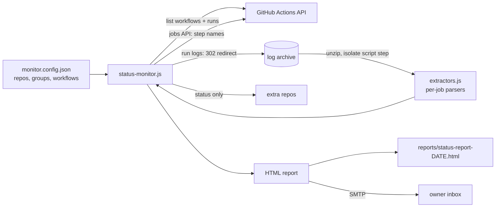

# Automation Health Monitor

A Node.js job that checks every GitHub Actions workflow in an automation suite once a day, reads the latest run's logs to work out what each job actually did, and emails a single HTML status report.

## The problem

A multi-channel e-commerce business ran around 30 scheduled automations as GitHub Actions: order sync, blog publishing, search indexing, email marketing, reporting and a customer-support bot in a second repo. The Actions tab tells you whether each run passed or failed. It does not tell you that a job went green and did nothing, that a weekly job silently stopped being scheduled, or that a manual tool hasn't been touched in two months. Checking 30 workflows by hand every day wasn't going to happen, so problems were found late.

## What it does

- Lists every workflow in the primary repo through the Actions API and looks up the latest completed run of each.
- Downloads that run's log archive, finds the main script step, and keeps only the script's own stdout (no checkout, cache or npm noise).
- Runs a per-workflow parser over that output to produce a one-line result, such as `1 published | 1 processed | 12 pending` or `412/530 indexed | 18 submitted today`.
- Counts and quotes error lines, ignoring false positives like `Failed: 0`.
- Classifies each workflow as OK, ERROR, WARNING (cancelled) or NOT RUN. "Recent" depends on the job's declared frequency: 30 hours for daily, 8 days for weekly, 32 days for monthly. A weekly job that last ran 3 days ago is therefore fine, and a daily job that last ran 3 days ago is flagged.
- Checks extra repos (for example a support bot) for pass/fail status only.
- Picks up workflows that aren't in the config, so a new job can't go unmonitored.
- Lists manual one-off tools in a separate "toolbox" section with their last-run date and a run link, so they don't get forgotten.
- Writes the report to `reports/` and emails it. The subject line says either "All Clear" or "Issues Detected".

## Architecture



| File | Role |
|---|---|
| `src/status-monitor.js` | Config loading, Actions API calls, log download and step isolation, status logic, HTML report, email |
| `src/extractors.js` | Log parsers: a generic "last meaningful lines" filter, error counting, and structured-summary parsers for specific jobs |
| `monitor.config.example.json` | Example config: groups, workflow labels and frequencies, extra repos |
| `.github/workflows/status-monitor.yml` | Daily schedule |

## Key design decisions

- **Results, not just status.** A green check means the process exited 0, which is not the same as the job having done its work. Each script in the suite prints a short, stable summary block at the end, and the monitor parses that block. The parsers are keyed by name in config (`"extract": "blogSummary"`), so adding a job means adding a JSON entry, not editing code.
- **Isolating the script's output.** The runner log is one combined file. In it, steps are delimited by `##[group]Run <command>` / `##[endgroup]` markers that use the shell command, not the YAML step name. The monitor finds the last `Run node …` group and captures everything from its `##[endgroup]` until the next group or `Post job cleanup`, stripping timestamps and ANSI codes. If the log can't be fetched or parsed, it falls back to a step summary from the Jobs API, and after that to "completed Nh ago".
- **Log download handles the redirect manually.** The logs endpoint returns a 302 to blob storage. If `fetch` follows it automatically, the GitHub `Authorization` header is forwarded and the storage host rejects the request. The monitor uses `redirect: 'manual'` and fetches the signed URL without auth.
- **Frequency-aware staleness.** Each workflow declares `daily`, `weekly` or `monthly`, and the "not run" window scales with it. That kept the report from going permanently yellow just because weekly jobs exist.
- **Failure isolation.** Each workflow is checked in its own try/catch, and if a check fails, that becomes an ERROR row instead of crashing the report. Extra repos are additive: an unreachable repo shows as a WARNING row with the reason, which is how a missing cross-repo token was diagnosed.
- **Cross-repo token.** The default `GITHUB_TOKEN` in Actions only covers its own repo. Extra repos use `EXTRA_REPOS_TOKEN`, a fine-grained PAT with Actions:read and Metadata:read, and fall back to `GITHUB_TOKEN` when it isn't set.
- **Read-only.** The workflow requests `actions: read` and `contents: read` and nothing else.
- **Output is escaped.** Log text and error lines are HTML-escaped before they go into the email.
- **Dry run.** `--no-email` builds and saves the report without sending it.

## Setup

```bash
npm install
cp .env.example .env
cp monitor.config.example.json monitor.config.json   # list your repos and workflows

npm run report:dry    # build reports/status-report-YYYY-MM-DD.html, no email
npm run report        # build and email
```

Environment variables (see `.env.example`):

| Variable | Purpose |
|---|---|
| `GITHUB_TOKEN` | Actions read access to the primary repo |
| `EXTRA_REPOS_TOKEN` | Optional PAT for repos in `extraRepos` (falls back to `GITHUB_TOKEN`) |
| `MONITOR_CONFIG` | Config path (default `monitor.config.json`) |
| `MONITOR_REPO` | Overrides `primaryRepo`. In Actions, the current repo is the fallback. |
| `STORE_NAME` | Name shown in the report header and subject |
| `REPORT_DIR` | Where HTML copies are written (default `reports`) |
| `SMTP_HOST`, `SMTP_PORT`, `SMTP_USER`, `SMTP_PASS` | Outgoing mail (Gmail with an app password works with the defaults) |
| `EMAIL_FROM`, `EMAIL_NOTIFY` | Sender and recipient |

Config shape, per workflow file name: `name`, `group`, `frequency` (`daily`/`weekly`/`monthly`), `schedule` (display text), `description`, optional `extract` (one of `lastMeaningful`, `blogSummary`, `gscNotIndexed`, `gscIndexing`, `contactSync`), `oneoff: true` for manual tools, and `skip: true` to hide a workflow (for example the monitor itself).

Requires Node 18+ (built-in `fetch`) and `unzip` on the PATH, which GitHub's Ubuntu runners include.

---

Extracted from a production automation suite I built and ran for a live e-commerce business, 2026.

© Michael Wootan. Source shared for portfolio review; all rights reserved.
